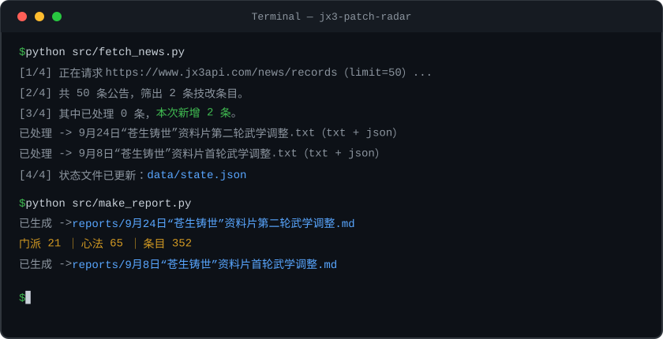

## 剑网3技改情报聚合器（jx3-patch-radar）
作用：自动抓取剑网3官方技改公告，解析成结构化数据，生成人类可读的技改简报。

## 效果演示
### 9月24日“苍生铸世”资料片第二轮武学调整

- 日期：2026/09/24
- 门派数：21 ｜ 心法数：65 ｜ 条目数：352

### 改动变化榜

| 排名 | 门派 | 条目数 |
| ---: | --- | ---: |
| 1 | 苍云 | 39 |
| 2 | 纯阳 | 36 |
| 3 | 长歌 | 26 |
| 4 | 丐帮 | 23 |
| 5 | 唐门 | 21 |
| 6 | 五毒 | 19 |
| 7 | 霸刀 | 18 |
| 8 | 七秀 | 17 |
| 9 | 刀宗 | 17 |
| 10 | 少林 | 17 |
| 11 | 北天药宗 | 14 |
| 12 | 衍天宗 | 14 |
| 13 | 无相楼 | 13 |
| 14 | 天策 | 11 |
| 15 | 明教 | 11 |
| 16 | 藏剑 | 11 |
| 17 | 万花 | 10 |
| 18 | 段氏 | 10 |
| 19 | 凌雪阁 | 9 |
| 20 | 蓬莱 | 9 |
| 21 | 万灵山庄 | 7 |

## 快速上手

```bash
git clone https://github.com/finklousenbarrel-hub/jx3-patch-radar.git
cd jx3-patch-radar
python -m venv .venv
source .venv/bin/activate        # Windows: .venv\Scripts\activate
pip install -r requirements.txt

python src/fetch_news.py         # 抓取公告落盘 txt（增量去重，重复运行零副作用）；txt → JSON 的解析由 parse_patch 完成
python src/make_report.py        # 生成 Markdown 简报到 reports/
```

终端实录（完整管道一瞥）：



## 快速上手：技改问答（ask.py）

在本地语料库（技能 558 条 + 技改 1869 条）里检索 top-3，交给 Kimi 回答，回答注明数据日期。语料已随仓库提交（data/），无需先跑抓取管道。

```bash
# 1. 安装依赖（含 openai / python-dotenv；跑过上面管道的可跳过）
pip install -r requirements.txt
```

2. 在项目根目录新建 `.env` 文件，写入一行（API key 到 [platform.moonshot.cn](https://platform.moonshot.cn) 申请）：

```
MOONSHOT_API_KEY=sk-你的key
```

```bash
# 3. 提问：单问单答
python src/ask.py "凌雪的铁马冰河cd多久"
# 无参数进入交互模式（逐行提问，空行退出）
python src/ask.py
```

问「凌雪的铁马冰河cd多久」的实测回答（节选）：

> **铁马冰河的基础调息时间为 20 秒**（依据技能库数据，日期 2026-10-13）。另外还有两个与调息相关的技改效果（依据 2026/09/08 公告）：沥血（被动）可使调息降低 7 秒……

更多问法：`"乱天狼cd多久"`（→ 15秒）、`"万花的沁逸改成什么了"`。想更新语料再跑 `python src/fetch_news.py` 与 `python src/fetch_skill_info.py` 即可。

## 它解决了什么问题
- 竞技场玩家的真实痛点：技改公告长、散、难追踪；
- 复刻 QQ 群技改机器人的核心能力：自建本地语料库
- 问答场景：技能 CD/效果随问随答，不用翻官网长公告

## 技术要点
- 技术选型：JX3API 综合版拉取 vs 事件推送 vs 硬抓SPA（详见 [tech-selection.md](docs/tech-selection.md)，含实验证据）
- 三级结构解析：门派/心法/条目，352 条精确验收
- 幂等增量管道：state.json 状态追踪，重复运行零副作用
- 简报生成：派生物全量重建

## 项目结构
- src/ 代码文件
  - fetch_news.py 抓取技改公告，存 txt（增量去重）
  - parse_patch.py 将 txt 解析为结构化 JSON
  - make_report.py 将 JSON 生成人类可读的 Markdown 简报
  - fetch_link_info.py 抓取首轮门派子文章全文（官网 api.php）
  - fetch_skill_info.py 抓取技能库快照（jx3.unua.top，每天最多一次）
  - retriever.py 技能库+技改库压平成文档库，2-gram TF-IDF 检索 top-3
  - ask.py 检索 top-3 拼 prompt，调 Kimi 问答
- tests/ pytest 测试（7 个文件共 93 项）
- data/ 抓取与解析结果：patches/（公告 txt+json）、skill-info/（技能库快照）、extra-info/（子文章全文与 plus 解析）、state.json（增量状态）
- reports/ 生成的 Markdown 简报（派生物）
- docs/ 开发日志与任务简报（docs/task-briefs）

## 数据源与限制
- 技改公告：JX3API 综合版（news/records），LV0 免 ticket；limit ≤ 50、历史窗口约一个月，无法追溯 2026 年 9 月之前的技改
- 首轮门派子文章：官网 api.php 全文抓取（fetch_link_info.py），已覆盖 9/8 首轮 21 门派
- 技能库：jx3.unua.top 快照（玩家自建站，无鉴权）；抓取纪律为每天最多请求一次，本地缓存后一切查询只读本地文件

## Roadmap

### ✅ 已完成（v1）
- 技改情报管道：官网公告 → 门派/心法/条目三级解析 → 结构化 JSON + Markdown 简报
- 技能库问答：TF-IDF 检索 + 名称加权（精确/模糊双档）+ Kimi 问答，支持错别字与简写

### 🚧 进行中（v2：多工具 Agent）
- **高分奇穴统计**："高分凌雪奇穴怎么点" → 调 JX3API 名剑排行（awesome）拉前 200，
  逐角色取战绩配置（recent），聚合奇穴选择率 → 数据来自推栏官方接口
- **版本强度问答**："这版本哪个 DPS 强势" → 名剑统计（schools）门派胜率
  × 本技改库版本改动交叉印证 → 用技改解读胜率变化，回答带数据日期

### 📋 规划（v3）
- 竞技场复盘助手：输入自己的战绩，对照高分同门派的奇穴差异给建议
- 奇穴/外号别名表：玩家口语（"吃--守拙""草--逐云寒蕊""强隐--暗尘弥散"）→ 正式名称映射